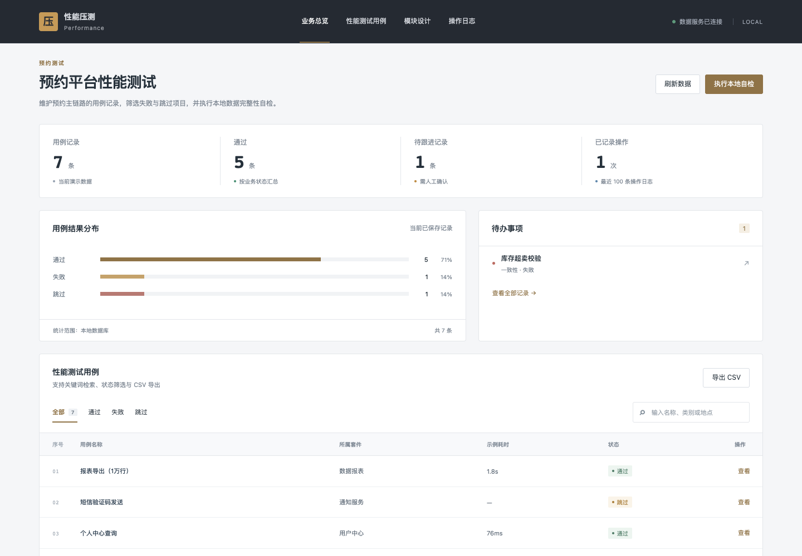

# 基于 JMeter 的小型预约平台性能测试管理系统的设计与实现

## 技术栈

- 当前演示：Vue 3、Python、SQLite。
- 选题方案：JMeter、Spring Boot、SQLite（部分技术尚未接入）。

## 项目功能

支持测试用例查询、筛选和维护，以及本地数据完整性自检。

完整方案规划包括：脚本管理、场景配置、阶梯加压、实时监控、结果分析、报告导出、环境管理、基线对比。部分功能尚待开发。

## 运行方式

在项目目录运行 `python3 backend/server.py`，然后访问 http://127.0.0.1:8000。

## 页面展示

## 微信联系

如果需要毕业设计，请扫描下方微信二维码联系。

